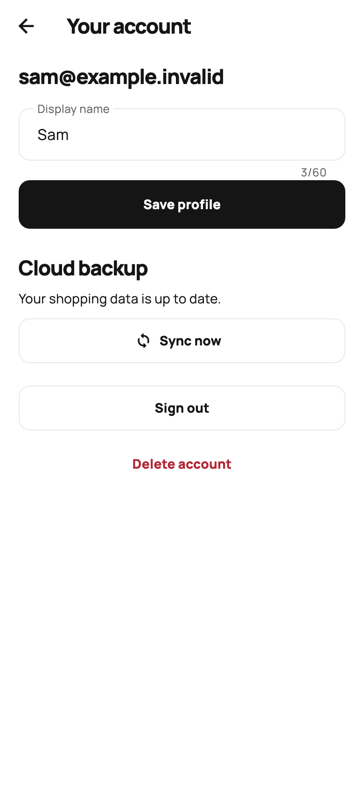
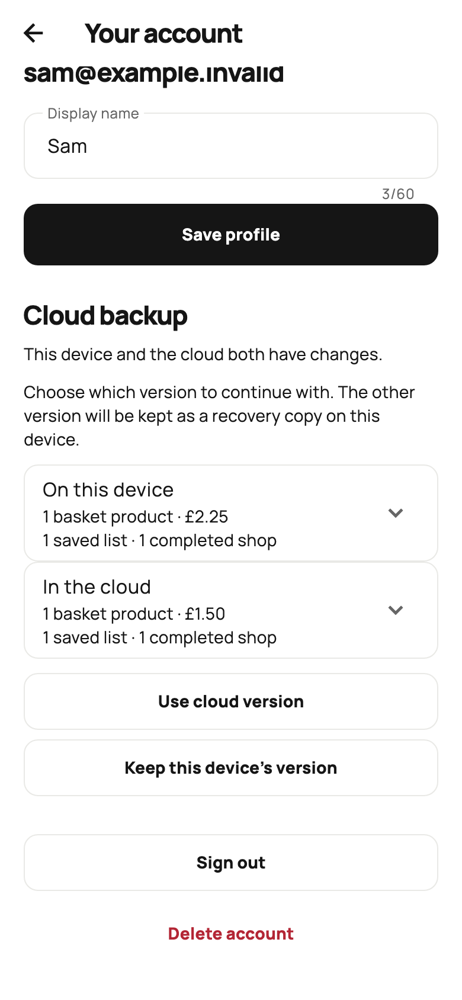
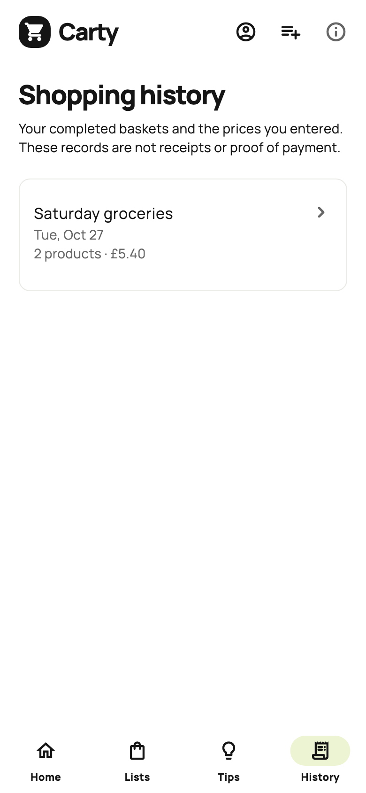

# Carty private cloud: phase one

The Carty Supabase project is in **Sammyadj's Organisation**, region **London (`eu-west-2`)**, project reference `igytgwdxljbnxfjtufui`. It was created on the quoted $0/month plan. No SMTP subscription or paid product service was configured.

## App configuration

`lib/config/supabase_config.dart` contains the project's URL and a **client-public publishable key**. This key identifies the project; authenticated database permissions protect the data. Never replace it with a secret or service-role key. Build overrides are available:

```sh
flutter run --dart-define=SUPABASE_URL=https://YOUR_PROJECT.supabase.co \
  --dart-define=SUPABASE_PUBLISHABLE_KEY=YOUR_PUBLIC_KEY
```

For local-only development, use `flutter run --dart-define=CARTY_CLOUD_DISABLED=true`. Guest data remains usable when account initialization is unavailable.

The exact allowed redirect is **`com.samueladjei.carty://auth/callback`**, registered under Authentication → URL Configuration. Android's intent filter and iOS's URL scheme handle it. Flutter's own deep-link routing is disabled so `supabase_flutter`/`app_links` can complete the PKCE exchange. The SDK predicate accepts only this scheme, host, and path. Keep these four settings in sync if the application identifier changes.

The app uses the default email **sign-in link**, not a six-digit code. Request the link and open it on the same device, where the PKCE verifier is stored. A successful verified callback selects the account workspace and closes old guest/account routes. The Supabase dashboard's default localhost site URL remains a fallback; mobile requests explicitly supply the registered callback.

Supabase's [default SMTP service](https://supabase.com/docs/guides/auth/auth-smtp) sends only to organisation team members and currently allows two emails per hour across the project. There is also a resend cooldown. It is for initial testing. Configure custom SMTP and review [auth rate limits](https://supabase.com/docs/guides/auth/rate-limits) before inviting public users. No email-confirmation protection was disabled to bypass these limits. Sign-in UI explains delivery restrictions without exposing raw backend errors.

## Schema and ownership

Apply the migrations in order when provisioning another project:

1. `supabase/migrations/20261027190000_private_cloud_workspaces.sql`
2. `supabase/migrations/20261027191000_require_workspace_fields.sql`

Both are already applied to the Carty project. Profiles and workspaces have row-level security. The authenticated user can read only their own records and update only their own profile. A workspace is a version-3 JSON snapshot, limited to 2 MiB, containing basket, budget, named lists, active-list link, and completed trips. It has a monotonically increasing revision.

Workspace writes go through `carty_save_workspace(expected_revision, snapshot)`. It derives ownership from `auth.uid()` and updates only the matching revision. A stale write returns no row and becomes a visible conflict. Direct table writes are not granted to clients. JSON shape constraints reject missing required arrays, including PostgreSQL CHECK expressions that would otherwise evaluate to null. The Flutter model validates complete item/list/history records before accepting cloud data.

`carty_delete_my_account()` takes no owner argument, deletes only `auth.uid()`, and cascades that user's profile and workspace. Both functions reject anonymous callers and use an empty SQL search path. They deliberately use `SECURITY DEFINER` with authenticated EXECUTE grants. Supabase's advisor reports [authenticated SECURITY DEFINER execution](https://supabase.com/docs/guides/database/database-linter?lint=0029_authenticated_security_definer_function_executable) for these two functions. These grants are intentional, narrowly scoped, and covered by cross-account tests; do not silence the warning by granting broader table access.

## Local saving, conflicts, and deletion

Guest preferences remain at their original key. Each signed-in account gets a separate key and an envelope containing its current snapshot, accepted cloud snapshot/revision, and one recovery copy. Device writes finish before an upload is scheduled. Offline edits remain pending, with retry after reconnecting, resuming, or selecting Sync now. A failed local write blocks upload until local saving succeeds.

Cloud and device edits are compared against the accepted revision. Competing changes require an explicit whole-workspace choice; quantities are never silently added together. The replaced version becomes the local recovery copy. If the cloud changes again while the choice is being reviewed, resolution stops for another review. Late responses cannot replace newer local edits or switch another account's visible data.

Guest lists/history are copied only after explicit confirmation. Sign-out retains the account cache for later offline use on the same device. Account deletion removes that account's server data and current-device cache; it cannot remotely erase another device's offline files. The product lookup cache is local and separate, and can still contain previously confirmed product names after account deletion. These are ordinary app-private preferences, not an encrypted vault or a remote device-management system.

## Verification

Verified on 27–28 October 2026 with Flutter 3.47.8 / Dart 3.13.7:

| Check | Result |
| --- | --- |
| Dart formatting and Flutter analysis | Pass |
| Full regression suite, including planning, categories, personal controls, and library management | 248 tests pass |
| Phone previews, including larger text | Rendered and reviewed |
| iOS Simulator Debug build, Xcode 27.1 | Pass |
| Android Debug build, Java 21 | Pass |
| Live Supabase ownership/revision/deletion SQL tests | Pass; fixtures rolled back |
| Mobile auth redirect allow list | Persisted and verified after reload |
| Real email delivery and two physical devices | Manual verification remains |

```sh
dart format lib test tool/render_design_previews.dart
flutter analyze
flutter test
```

Tests cover offline writes, stale requests, account isolation, failed local saves, revision conflicts, recovery copies, profile switching, guest import, history migration, email-link requests, and narrow screens with larger text. The Supabase adapter tests use a fake HTTP server and send no emails.

Run `supabase/tests/phase_one_security.sql` against a development database through the SQL editor or database tooling. It creates synthetic `.invalid` users inside a transaction, checks ownership policies, revision checks, invalid snapshots, anonymous permissions, and deletion isolation, then rolls everything back. It was run successfully against Carty; no fixture users or shopping records were retained.

Before release, manually verify an actual sign-in email on each mobile platform, cold-start callback handling, expired links, sign-out/restart, offline editing, and conflicting edits on two physical devices. Also verify account deletion from another signed-in device, privacy disclosures, export/recovery requirements, and production signing. Automated adapter and database tests do not prove mail delivery or real-device behavior.

## Review screens

These images render actual Flutter widgets with in-memory sample data. No real account or shopping record is used.

| Email sign-in | Profile and sync |
| --- | --- |
|  |  |

| Conflict review | Completed shops |
| --- | --- |
|  |  |

Also review [trip details](previews/cloud-trip.png), [larger sign-in text](previews/cloud-sign-in-large-text.png), and [larger trip text](previews/cloud-trip-large-text.png). Regenerate with `flutter test tool/render_cloud_previews.dart`; `tool/render_design_previews.dart` updates the City Home and Basket previews.
