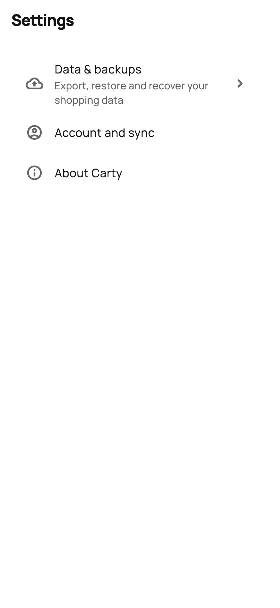
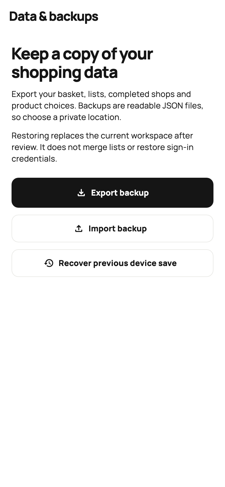
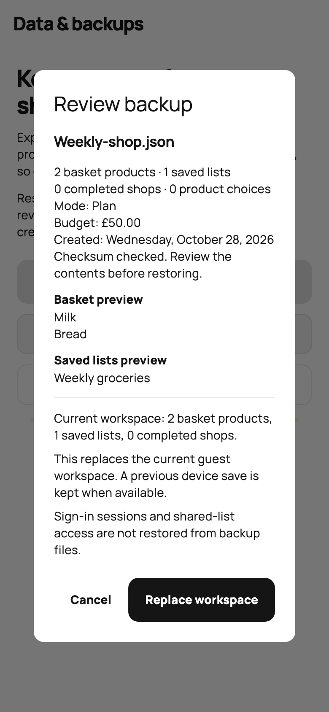
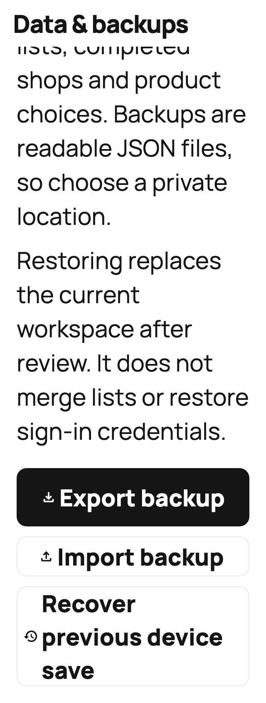

# Device storage and portable backups

## Shopping database

Carty now stores shopping records in `carty-shopping.db` in the app's private
database directory. Basket items, named lists and their items, completed trips
and their original plans, and product choices are separate SQLite rows. Guest
and account scopes are checked on every read; account caches also retain their
accepted cloud revision, base, and cloud conflict recovery copy.

Updates run in transactions. Unchanged shopping rows are retained, and a failed
write rolls back the entire save. A bounded one-step undo journal records the
changed rows from the preceding device save. It is recovery for the previous
save, not a permanent version history. Further shopping changes replace it.
SQLite is app-private storage, not an encrypted vault.

On first use, a scope's old preference value is validated, decomposed, and copied
in one transaction. Its original value stays untouched as a migration backup.
A delayed migration cannot replace newer SQLite data. Invalid data and newer
database schemas are preserved rather than silently reset. Explicit account
deletion clears its database rows and old preference key; a deletion marker
prevents reimporting an older copy if preference cleanup fails. Other account
scopes and guest records are kept. Sign-out retains the account cache.

The barcode product lookup cache and authentication SDK use their own storage.
Shopping database migration does not copy credentials into shopping records.

## Export, import, and recovery

Home → **Settings** → **Data & backups** provides:

- **Export backup:** choose a file location using the native picker. The JSON
  contains the basket, budget, Plan/Shop mode, saved lists, active-list link,
  history, and product choices. It excludes sign-in tokens, keys, profile email,
  cloud revision, and shared-list access. An explicit rescue option can export
  currently visible edits after a local save fails; it cannot export unreadable
  saved records.
- **Import backup:** choose a JSON file, then review counts, budget, mode,
  creation date when available, checksum status, and sample names. Cancel keeps
  the current workspace. Confirming replaces the entire selected workspace;
  there is no automatic merge. Signed-in restores subsequently sync to the
  account through the existing conflict checks.
- **Recover previous device save:** review the one-step local recovery copy.
  This also replaces the workspace only after confirmation. Recovery does not
  invent a file creation date or claim that a file checksum was checked.

Files are capped at 20 MiB, decoded outside the UI isolate, and fully validated
before review. Version-1 backup envelopes contain a SHA-256 checksum of canonical
shopping JSON and declare GBP. Older valid raw snapshots are accepted with a
visible no-checksum notice and normalized before restore. A checksum detects
damage; it is not proof of who made a file. Backups are readable and unencrypted,
so choose a private location.

A restore is saved before replacing visible state. If the workspace changes
during review or while the write is pending, newer edits win. Failed writes show
a saving error and keep the current working data visible. Keep Carty open and
retry saving after storage failures. No export or device recovery can guarantee
recovery after uninstalling or losing a device.

## Verification and current limits

Real SQLite tests cover migration, a competing migration, account separation,
transaction failure, one-row edits in a 1,000-item workspace, previous-save
recovery, malformed rows, and refusal to downgrade a newer database. Restore
tests cover stale review, edits/cloud updates during disk writes, old snapshots,
and failed writes. UI tests cover native-file cancellation via injected IO,
review/confirm/cancel, rescue export, Settings navigation, and narrow screens
with doubled text size. Native file picker presentation still needs physical
iOS and Android acceptance testing.

Local and upgraded cloud storage use separate records. Cloud protocol 2 pages
downloads and sends row deltas under atomic revision checks; whole-workspace
conflict review remains. See [cloud record storage](CLOUD_RECORDS.md) for migration,
limits, and verification. Household sharing remains in the
[active implementation checklist](IMPLEMENTATION_PROGRESS.md).

## Review screens

These show actual widgets with synthetic in-memory data. Regenerate with
`flutter test tool/render_backup_previews.dart`.

| Settings | Backup controls |
| --- | --- |
|  |  |

| Reviewed import | Larger text |
| --- | --- |
|  |  |
