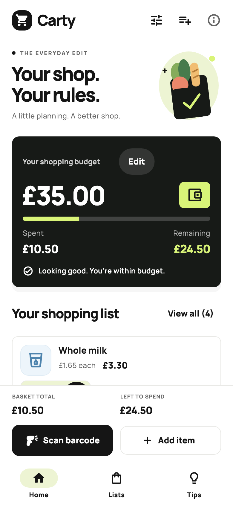
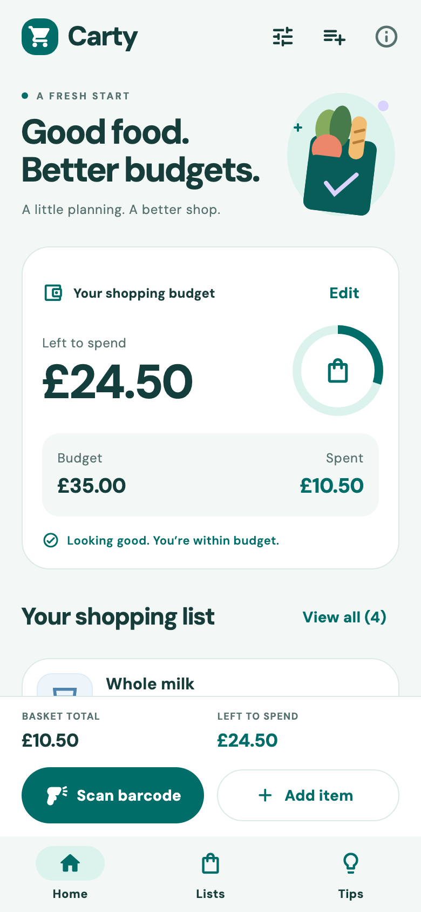
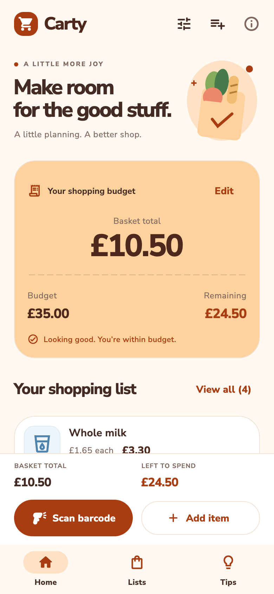

# Carty UI exploration

This branch explores three visual directions over the same shopping state and workflows. The preview switcher changes presentation without replacing the cart, budget, saved lists, or product lookup service. The default is City; the preview choice resets when the app restarts.

## Review the options

| City | Fresh | Pantry |
| --- | --- | --- |
| Bold, monochrome, lime accents. Manrope typography and a budget-first card. Inspired by the focus and contrast of Uber Eats. | Cool teal, lilac accents, DM Sans, spacious white cards and a remaining-budget ring. Inspired by Deliveroo's light retail styling. | Warm orange, cream, rounded Nunito Sans, and a receipt-style basket total. Inspired by Just Eat's warmth and approachable shapes. |
|  |  |  |
| [City basket](previews/city-basket.png) | [Fresh basket](previews/fresh-basket.png) | [Pantry basket](previews/pantry-basket.png) |

These are actual Flutter renders at a 390 × 844 logical phone size, captured at 2× resolution. They contain in-memory sample groceries, not the shopper's saved data. Camera capture and retailer prices are not simulated by the screenshots.

## Try them in the app

Run this worktree using Flutter 3.47.8, or open its `ios/Runner.xcworkspace` in Xcode. Tap the sliders icon in the Home toolbar (**Explore designs**) and choose City, Fresh, or Pantry. The current basket stays in place. Try adding and editing an item, setting a budget, saving/reusing a list, starting a new list, and scanning a barcode.

The three styles share the same implementation on `codex/ui-exploration` so comparisons use identical behaviour and data. A chosen direction can be kept on its own branch after review without maintaining three copies of the shopping logic. The main checkout has not been modified by this experiment.

## Visual references and assets

Public references inspected: [Uber Eats groceries](https://www.ubereats.com/near-me/grocery), [Deliveroo](https://deliveroo.co.uk/), and [Just Eat](https://www.just-eat.co.uk/). These are original Carty adaptations of the observed visual patterns, not reproductions of the native applications. Carty retains its own name, original vector grocery artwork, and locally bundled fonts.

The official [REA project](https://github.com/morluto/rea) was reviewed during setup. This first visual pass uses public interface inspection; it does not claim REA-based binary analysis. REA is not installed in this environment, whose default Node 22.4.1 is below REA's documented supported Node 22 minimum. Deeper native investigation would also need the target application artifact and an analysis provider.

Manrope, DM Sans, and Nunito Sans come from [Google Fonts](https://github.com/google/fonts/tree/main/ofl). Their SIL Open Font License files are bundled in `assets/fonts` and available through the app's license screen. No third-party logos, proprietary fonts, or product photography are bundled.

## Verification and regeneration

`flutter analyze` is clean and all 111 tests pass, including state preservation across switches and 320px layouts at 1.5× text. Existing cart, list, scanner, lookup, persistence, and manual-price tests are retained.

Regenerate the six screenshots with:

```sh
flutter test tool/render_design_previews.dart
```

The test uses each real design theme, bundled fonts, and a private in-memory cart. Re-run it after changes to typography, layout, or shared components.
